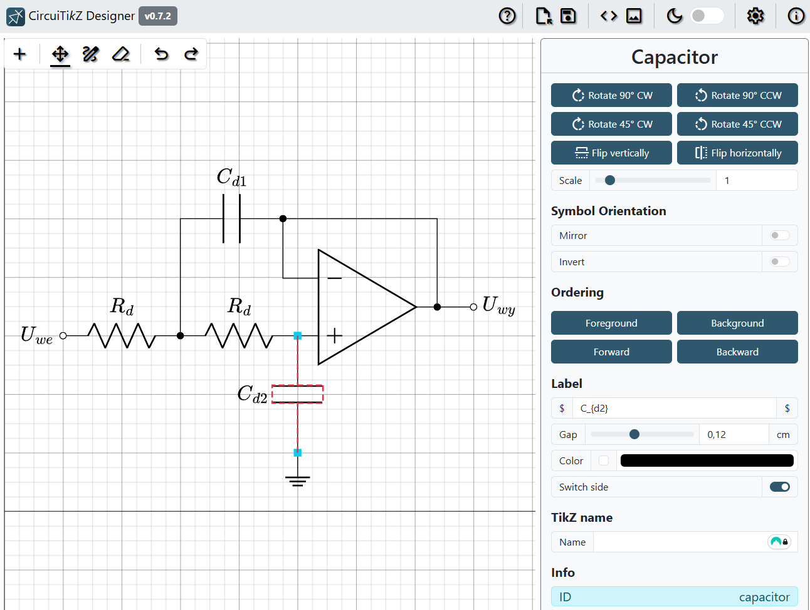
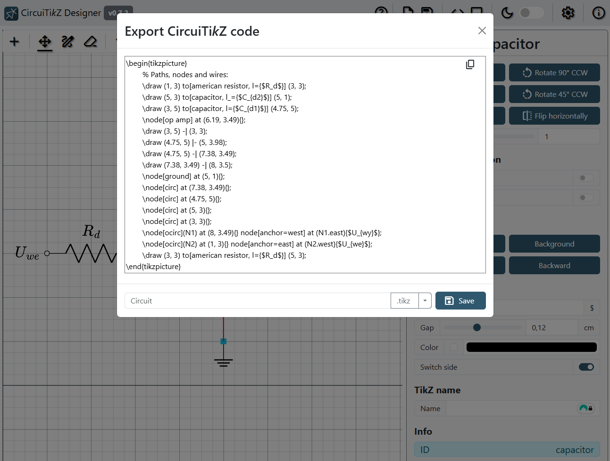
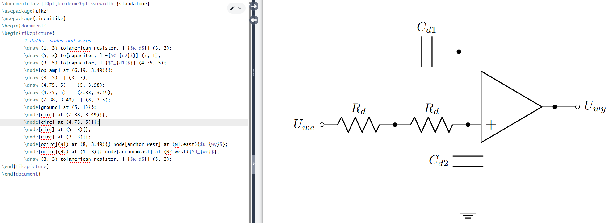

# CircuiTi*k*Z-Designer

<p align="center">
  
</p>

<p align="center">
  <strong>An interactive, visual CAD studio for designing electrical circuits and generating production-ready LaTeX / CircuiTi<i>k</i>Z code.</strong>
</p>

<p align="center">
  <a href="https://github.com/nhat-vien/CircuiTikZ-Designer/releases/tag/v0.9.1"></a>
  <a href="LICENSE"></a>
  <a href="https://nodejs.org/"></a>
  
  <a href="https://circuit2tikz.tf.fau.de/designer/"></a>
</p>

---

## ⚡ Overview

**CircuiTi*k*Z-Designer** bridges the gap between visual schematic capture and publication-quality LaTeX documents. Instead of painstakingly calculating coordinates and typing verbose TikZ commands by hand, you can visually assemble, customize, and export circuits with complete precision.

Whether you are writing academic papers, preparing university lecture slides, or publishing engineering documentation, CircuiTi*k*Z-Designer delivers clean, idiomatic LaTeX output ready for Overleaf, TeX Live, or Tectonic.

| Edit in CircuiTi*k*Z-Designer | Export to Compilable Ti*k*Z Code |
| :---: | :---: |
|  |  |

| Use directly in your LaTeX project! |
| :---: |
|  |

---

## ✨ Key Features (v0.9.1)

### 🎨 Modern CAD Workspace & Clean Layout
- **Redesigned 3-Zone Navigation Header**: Organized with `File` and `Export` menus on the left, intuitive CAD drawing tools in the center, and quick-toggle actions (`Live TikZ`, `Grid & View`, Theme, Help) on the right.
- **Conflict-Free 3-Column Layout**: 
  - **Left**: Collapsible **Symbols Library** drawer docked neatly beneath the navbar.
  - **Center**: Infinite pan-and-zoom interactive circuit **Canvas**.
  - **Right**: **CircuiTikZ Document** panel and **Properties & Settings Inspector** positioned side-by-side without overlapping or cluttering the component drawer.

### 🔄 Bi-Directional LaTeX Document Synchronization
- **CodeMirror 6 Live Editor**: The code drawer is a full LaTeX editor with syntax highlighting and dark-mode support.
- **Two-Way Binding**: Moving or adding components immediately generates clean CircuiTikZ markup; editing the LaTeX source syncs changes straight back onto the canvas.
- **Code Preservation**: Custom `\coordinate` declarations, comments (`%`), and manual annotations are preserved verbatim ("free entries") across canvas operations.

### 📐 Comprehensive Component Library
- **Passive & Active Elements**: Resistors (American/European), capacitors, inductors, diodes, Zener diodes, BJTs, FETs, and vacuum tubes.
- **Integrated Circuits & Logic**: Op-amps, comparators, 555 timers, logic gates (AND, OR, NOT, NAND, NOR, XOR), flip-flops (D, JK, SR, T).
- **Wiring & Power**: Ground symbols, supply rails, voltage/current arrows, switches, and push buttons.
- **Geometric & Flowchart Shapes**: Blocks, flowchart decisions, inputs/outputs, annotations, lines, and curved arrows.

### ⚡ Smart Wiring & CAD Operations
- **Automatic Junction Dots**: Generates `node[circ]` junction dots automatically whenever 3 or more wire segments connect at a node.
- **Interactive Wire Splitting**: Right-click on existing wires to split at the closest vertex while retaining line styles, arrows, and labels.
- **Snap-to-Grid & Orthogonal Routing**: Precision positioning with configurable grid sizes and subdivision levels.
- **Batch Editing**: Rotate, flip, align, distribute, scale, and group components with ease.

### 🖨️ True LaTeX Compilation Preview
- **Desktop (Electron)**: Render circuits on-the-fly using local Tectonic or `pdflatex` installations.
- **Web (Standalone Server)**: Optional zero-dependency render server (`server/renderServer.js` or Docker image) with auto-recompile and status indicators.

### 🏷️ MathJax & Typography
- Render real-time mathematical formulas using MathJax syntax inside labels and text annotations.

---

## 🚀 Getting Started

### Prerequisites
- [Node.js](https://nodejs.org/) (version 18 or newer recommended)
- `npm` or `yarn`

### Installation & Local Run

```bash
# 1. Clone the repository
git clone https://github.com/nhat-vien/CircuiTikZ-Designer.git
cd CircuiTikZ-Designer

# 2. Install dependencies
npm install

# 3. Start development server
npm start
```

Visit the local development URL displayed in your terminal (typically `http://localhost:1234`).

### Running Tests

```bash
# Run unit tests via Vitest
npm test
```

### Production Build

```bash
# Compile and bundle static files for deployment
npm run build
```

The production assets will be generated in the `dist/` directory.

---

## ⌨️ Useful Keyboard Shortcuts

| Shortcut | Action |
| :--- | :--- |
| `Ctrl + Z` / `Cmd + Z` | Undo |
| `Ctrl + Y` / `Cmd + Shift + Z` | Redo |
| `Delete` / `Backspace` | Delete selected components or wires |
| `R` | Rotate selected component 90° clockwise |
| `Shift + R` | Rotate selected component 90° counter-clockwise |
| `Space + Drag` / Middle Click | Pan canvas |
| `Scroll Wheel` | Zoom in / out |
| `Ctrl + A` | Select all elements |
| `Escape` | Deselect / Return to select tool |

---

## 🐳 Optional: LaTeX Render Server (Web Mode)

To enable live rendered PDF/SVG previews when running in a web browser without a local TeX distribution:

```bash
# Navigate to server directory
cd server

# Run directly (requires tectonic or pdflatex installed)
node renderServer.js --port 3000

# Or build and run via Docker
docker build -t circuitikz-render-server .
docker run -p 3000:3000 circuitikz-render-server
```

In the app under **Grid & View / Settings**, set the render server URL to `http://localhost:3000`.

---

## 🤝 Contributing

Contributions, bug reports, and suggestions are welcome!

- **Bug Reports**: Open an issue on GitHub with steps to reproduce and circuit state if applicable.
- **Feature Requests**: Start a discussion in the [Discussions](https://github.com/Circuit2TikZ/CircuiTikZ-Designer/discussions) tab.
- **Pull Requests**:
  1. Fork the repository.
  2. Create a feature branch (`git checkout -b feature/amazing-feature`).
  3. Ensure all tests pass (`npm test`).
  4. Commit your changes (`git commit -m 'feat: add amazing feature'`).
  5. Push to the branch and submit a PR.

---

## 📜 License

This project is licensed under the **GNU General Public License v3.0** (`GPL-3.0-only`). See the [LICENSE](LICENSE) file for full details.

---

<p align="center">
  Built with ❤️ for the LaTeX & Electronics Engineering community.
</p>
